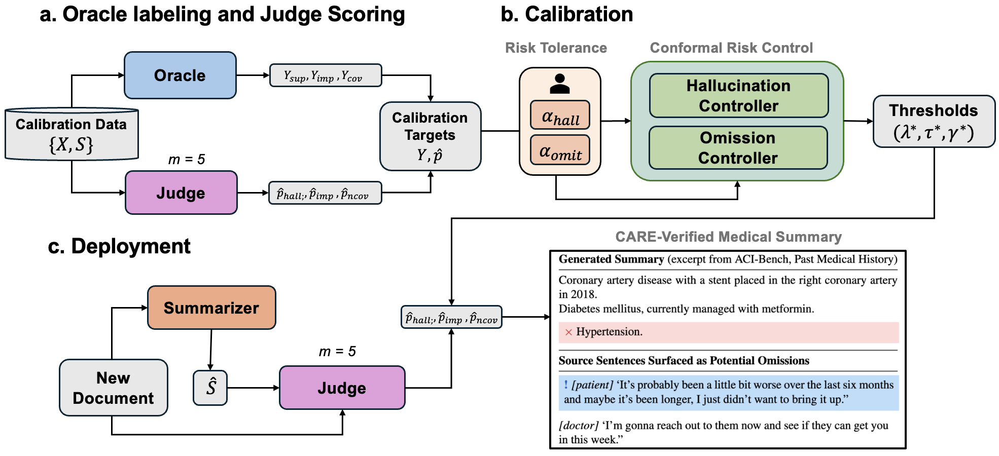

# CARE: Conformal Assessment for Risk Evaluation

Post-hoc conformal risk control for clinical summarization with **finite-sample, distribution-free guarantees** on factual error risk and omission risk.

<p align="center">
  
</p>

## Overview

CARE is a **post-hoc safety layer** that overlays calibrated risk signals on black-box LLM summaries without retraining:

1. **Hallucination Controller**: Flags potentially non-factual summary sentences (1D scalar CRC).
2. **Omission Controller**: Surfaces important source content missing from summaries. The **primary** method is **LTT-FST** (Learn-Then-Test with fixed-sequence testing) over the importance × non-coverage grid; the **2D-Joint** method is retained as a heuristic comparator.

Human references are used **offline only** for calibration — never at test time.

## Setup

```bash
pip install -e .                 # core: pipeline + main tables/figures
pip install -e ".[scorers]"      # optional: non-LLM scorers (NLI/BERTScore/AlignScore) + cost table; GPU recommended
```

Tests: `pip install -e ".[dev]" && pytest tests/`

The optional external scorers also need AlignScore weights, installed separately
(see https://github.com/yuh-zha/AlignScore) and pointed at via that library.

Create `.env` (copy from `.env.example`) with your API keys:

```bash
LLM_API_KEY=your_key_here  # API gateway key (GPT / Llama / Claude / Gemini)
BEDROCK_API_KEY=                 # optional, for Bedrock-hosted models
```

### Data access

All pre-computed model outputs (judge/oracle scores, splits) are read from
`CARE_DATA_ROOT`. The clinical datasets are **not** distributed with this repo —
they contain protected health information and are governed by their respective
data-use agreements (MIMIC via PhysioNet, etc.). With access to that data:

```bash
export CARE_DATA_ROOT=/path/to/your/data
```

## Repo Structure

```
care/                        # Core pipeline package
├── config.py                # Paths, datasets, models, hyperparams
├── utils.py                 # LLM client (Azure OpenAI, Bedrock), I/O helpers
├── prompts.py               # Domain-specific LLM prompts
├── filters.py               # Deterministic sentence filters
├── split.py                 # Phase 0: data splitting
├── oracle.py                # Phase 1: oracle labeling (GPT-5)
├── scoring.py               # Phase 2: vote-rate scoring (GPT-5-mini, m=5)
├── calibration.py           # Phase 3: CRC threshold selection
└── evaluation.py            # Phase 4: test evaluation + baselines

paper/
├── scripts/                 # Table + figure generation scripts
└── outputs/                 # Generated .tex, .png, .json, .csv

reproduce.sh                 # Regenerate all tables and figures
```

## Pipeline

```bash
# Phase 1: Oracle labeling
python3 -m care.oracle --dataset aci --resume

# Phase 2: Judge scoring (m=5 replicates)
python3 -m care.scoring --dataset aci --parallel-workers 4

# Phase 3: CRC calibration
python3 -m care.calibration --dataset aci --alpha-fact 0.15 --alpha-omit 0.15

# Phase 4: Test evaluation
python3 -m care.evaluation --dataset aci
```

To use a different summarizer (e.g., Claude Opus via Bedrock):
```bash
CRC_SUMMARIZER_MODEL="bedrock/us.anthropic.claude-opus-4-20250514-v1:0" \
python3 -m care.oracle --dataset aci --output-dir /path/to/output --no-cache
```

## Reproduce Paper Results

```bash
./reproduce.sh    # regenerates all tables + figures into paper/outputs/
```

`reproduce.sh` runs each step with a non-fatal wrapper: a failed step prints a
warning and the script continues, then summarizes failures at the end. Steps
marked `[optional]` need extra resources (a GPU for the external scorers, the
clinician-study data for the human-eval tables, or the Llama tokenizer for the
cost table) and are expected to be skipped in a stock environment.

## Running on your own dataset

The pipeline is dataset-agnostic. Point `CARE_DATA_ROOT` at a directory laid
out as `{CARE_DATA_ROOT}/{YourDataset}/split/{calibration,test}.jsonl`, where
each line is a document with its source and summary sentences. Then:

1. Register the dataset in `care/config.py`: add a folder mapping in
   `configure_dataset()` and add its short name to the `--dataset` `choices`
   list in `care/{oracle,scoring,calibration,evaluation}.py`.
2. Run the four phases (each writes into `{CARE_DATA_ROOT}/{YourDataset}/phase_*`):

```bash
python3 -m care.oracle      --dataset mydata --resume
python3 -m care.scoring     --dataset mydata --parallel-workers 4
python3 -m care.calibration --dataset mydata --alpha-fact 0.15 --alpha-omit 0.15
python3 -m care.evaluation  --dataset mydata
```

Phase 3 writes the deployed LTT-FST omission thresholds to the `omission` key of
`conformal_thresholds.json` (`select_omission_threshold_ltt_fst`; `--delta`,
default 0.05; `omission_ltt_fst` is an alias). The 2D-Joint comparator is stored
under `omission_2d_joint`. Phase 4 (`care.evaluation`) deploys the LTT-FST entry;
Phase 3 files written before LTT-FST hold only 2D-Joint, and Phase 4 asks you to
re-run Phase 3 for them. Use the stored, unrounded values. No human
references are required at test time — only offline for calibration.

## Datasets

| Dataset | N | Cal/Test | Description |
|---------|---|----------|-------------|
| **ACI-Bench** | 123 | 86/37 | Doctor–patient clinical dialogues → visit notes |
| **MIMIC-BHC** | 500 | 350/150 | Discharge records → brief hospital course |
| **MIMIC-CXR** | 500 | 350/150 | Radiology findings → impressions |
| **Priv-DS** | 500 | 350/150 | Multi-note encounter records → discharge summaries |
| **SumPubMed** | 500 | 350/150 | Research articles → abstracts |

All datasets use α = 0.15, seed = 42, 70/30 cal/test split.

## Method

**Hallucination Controller** — 1D CRC:
- Flag set: F_λ(X) = {v : p̂_hall(v) ≤ λ}
- Loss: L = 1{any unflagged hallucination exists}
- λ* = smallest λ satisfying the CRC bound
- L is monotone non-increasing in λ, so scalar CRC gives E[L] ≤ α with the
  finite-sample (n + 1) correction

**Omission Controller** — LTT-FST (primary):
- Surfaced set: O_{τ,γ}(X) = {u : p̂_imp(u) ≥ τ AND (1 − p̂_cov(u)) ≥ γ}
- Loss: fractional — n_missed / n_total omissions per document
- Test order: grid cells sorted by τ + γ ascending (permissive → restrictive),
  fixed before seeing data. Each cell's null H: R(τ, γ) > α is tested with a
  Hoeffding–Bentkus p-value; testing stops at the first non-rejection.
- Every certified cell satisfies **Pr( R(τ, γ) ≤ α ) ≥ 1 − δ simultaneously**
  over the calibration draw (Learn-Then-Test, Angelopoulos et al., Thm 1;
  fixed-sequence FWER control, no Bonferroni penalty). We deploy the certified
  cell with the lowest mean calibration workload (`deploy="min_workload"`;
  `"last"` reproduces the submitted paper). Defaults: α = 0.15, δ = 0.05.
- The loss is monotone non-increasing as τ or γ decreases (more is surfaced),
  but LTT does not rely on monotonicity along the ordering. With R̂ = 0 the
  p-value is (1 − α)ⁿ, so at α = 0.15, δ = 0.05 nothing is certifiable for
  n < 19; the controller then falls back to (0, 0) (surface everything).
- The **2D-Joint** controller (workload-minimizing pair among all cells that pass
  the CRC bound) is kept only as a comparator. Selecting over the grid after
  seeing the data voids the CRC argument, so it has **no formal guarantee**.

Implementation: `care.calibration.select_omission_threshold_ltt_fst`
(primary), `select_omission_threshold_2d_fractional` (comparator), and the
legacy CRC-bound scan `select_omission_threshold_fst_fractional` (comparison only).

**Key finding**: Partially calibrated pipelines violate guarantees (up to 50%); marginal decompositions are valid but conservative; LTT-FST reaches the safety–efficiency Pareto frontier with rigorous finite-sample control.

## Citation

```bibtex
@article{care2026,
  title={CARE: A Conformal Safety Layer for Medical Summarization},
  booktitle = {Proceedings of the Sixth Machine Learning for Health Symposium},
  author={Bedi, Suhana and Lin, Bridget and Zhou, Anson Y. and Stanwyck, Chloe O. and Jindal, Jenelle A. and Koyejo, Sanmi and Stutz, David and Shah, Nigam H.},
  year={2026},
  archivePrefix={arXiv},
  primaryClass={cs.AI},
  url={https://arxiv.org/abs/2606.08969}
}
```
